# IAW: Exercici 1

## Introducció a Git i GitHub

**Alumne:** Ryan Alcañiz  
**Professor:** Juanjo Felis  
**Curs:** 2n ASIX

---

## 1. Accés als repositoris remots

La forma d’accedir als repositoris remots de GitHub serà per SSH. Per tant, he de copiar la meua clau pública RSA a GitHub. Procedisc:

**Figura 1. Cree una clau SSH.**

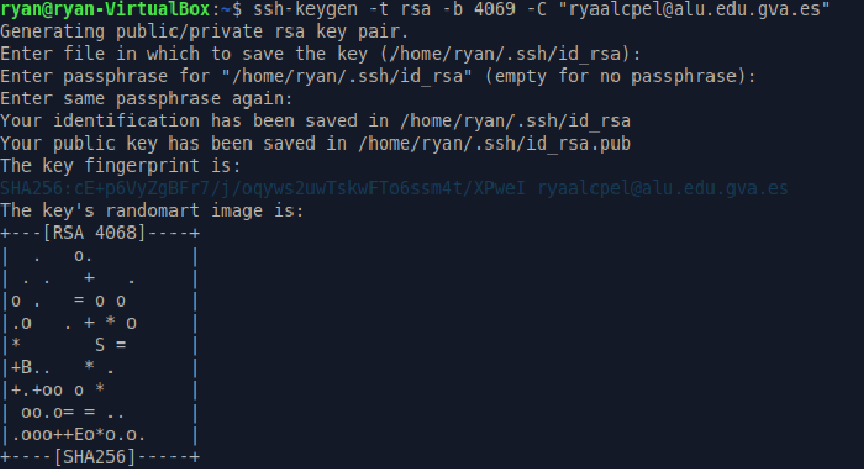

**Figura 2. Afegisc la clau al meu GitHub.**

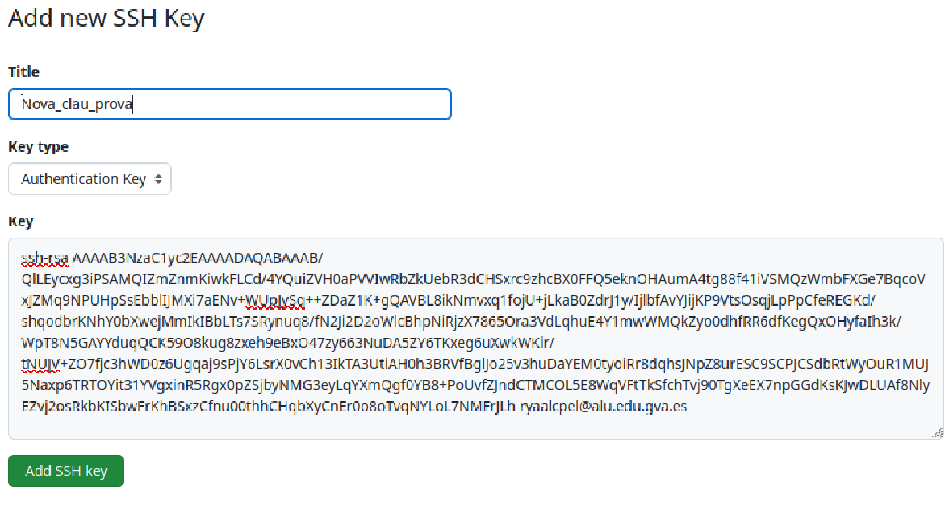

Ara faig el mateix, però fent-ho amb tokens.

**Figura 3. Genere un token.**

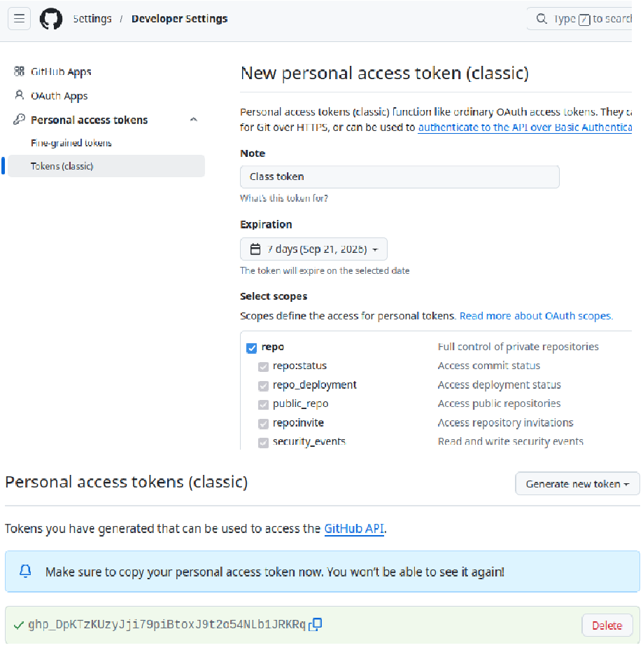

## 2. Crear un repositori a GitHub

Crea a GitHub un repositori amb el nom `prova_el_teu_nom` i la descripció «Repositorio de prueba 2ASIX».

**Figura 4. Cree el meu repositori a GitHub.**

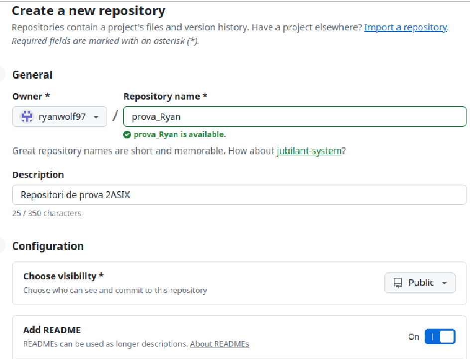

## 3. Instal·lar Git

Instal·la Git en el teu ordinador.

**Figura 5. Instal·lació de Git a la MV Xubuntu.**

## 4. Configuració de Git

**Figura 6. Establisc el nom d’usuari amb la meua adreça de correu electrònic.**

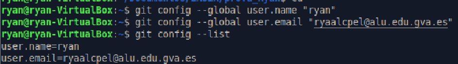

Ara vaig a clonar el repositori remot al meu ordinador.

**Figura 7. Clonació del repositori.**

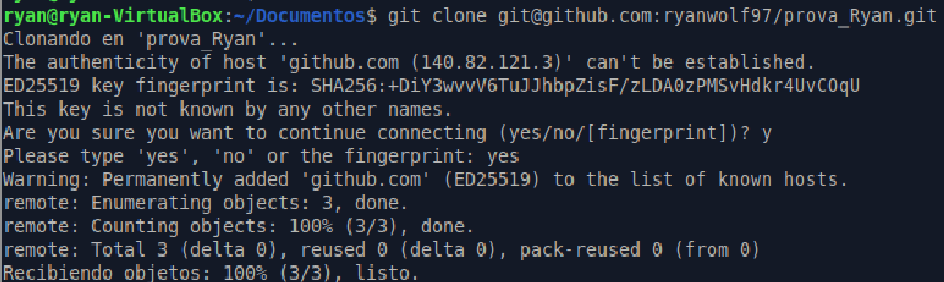

Comprovació que s’ha configurat el repositori utilitzant l’URL SSH.

**Figura 8. Comprovació.**

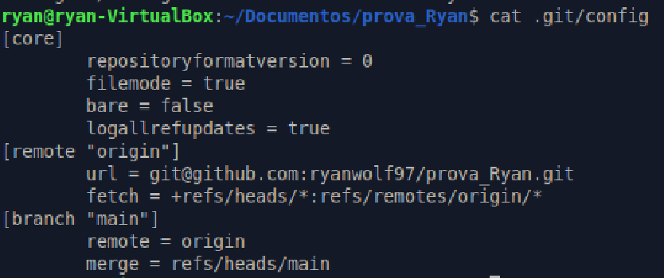

Dins del repositori ha d’estar el fitxer `README.md`.

**Figura 9. Comprovació de l’interior del repositori.**

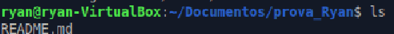

## 5. Treball amb fitxers i sincronització

Crearem un fitxer nou, l’afegirem al nostre repositori local i després el sincronitzarem amb el nostre repositori remot de GitHub.

**Figura 10. Cree el fitxer nou i ho comprove.**

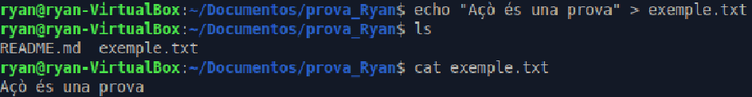

Ara procedisc a pujar-lo a GitHub.

**Figura 11. Puge el contingut a GitHub.**

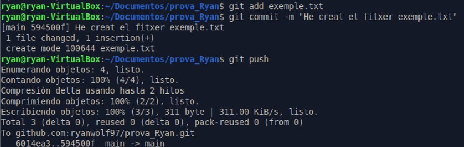

Procedisc a modificar les dades.

**Figura 12. Modificació del fitxer.**

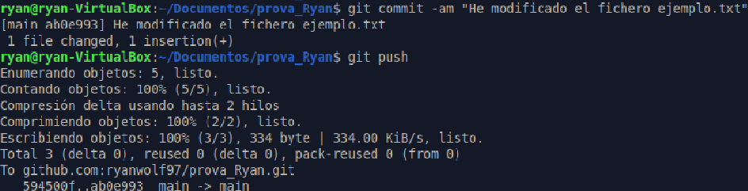

Canvie el nom del fitxer.

**Figura 13. Canvi de nom.**

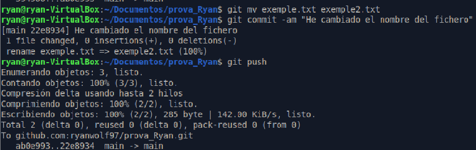

Per esborrar el fitxer del repositori:

**Figura 14. Esborre el fitxer del repositori.**

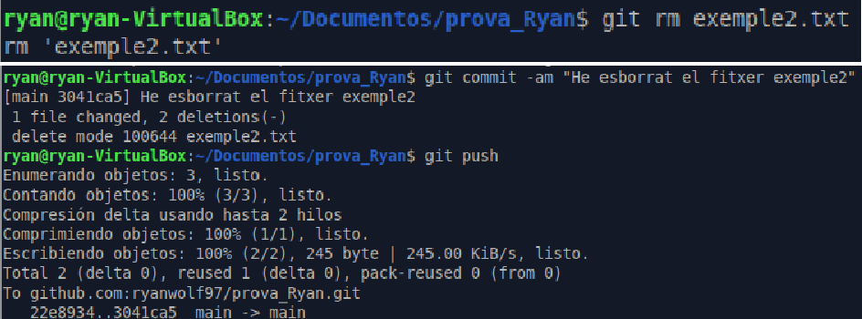

Abans de treballar en un repositori local, has de sincronitzar els possibles canvis que s’hagen produït al repositori remot. Per això:

**Figura 15. Baixe les dades de GitHub al meu PC.**

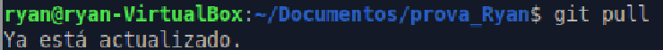

Per comprovar l’estat del meu repositori local:

**Figura 16. Comprove l’estat del repositori.**

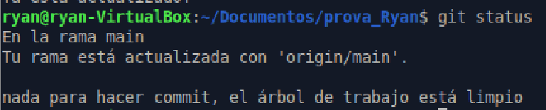

## 6. Crear un repositori local i sincronitzar-lo amb GitHub

Cree un nou repositori anomenat `prova2_el_teu_nom`. En aquesta ocasió, crea primer el repositori local i després cerca informació per sincronitzar-lo i crear el repositori remot a GitHub.

**Figura 17. Cree el repositori en local.**

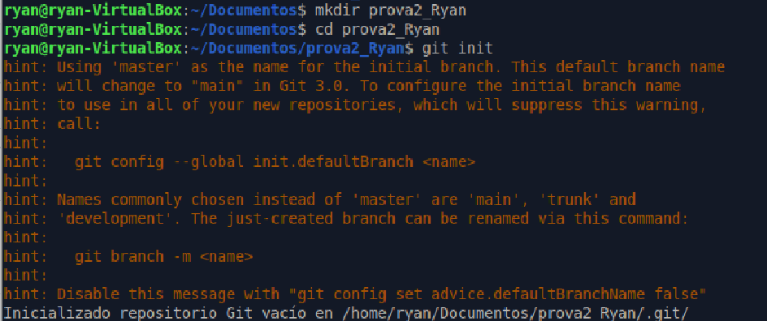

Li afegisc dades dins del repositori.

**Figura 18. Genere les dades dins del repositori.**

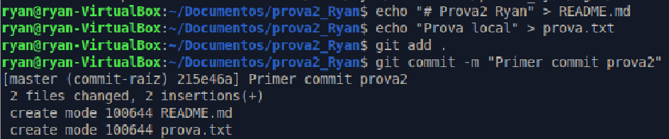

**Figura 19. Cree el repositori buit a GitHub.**

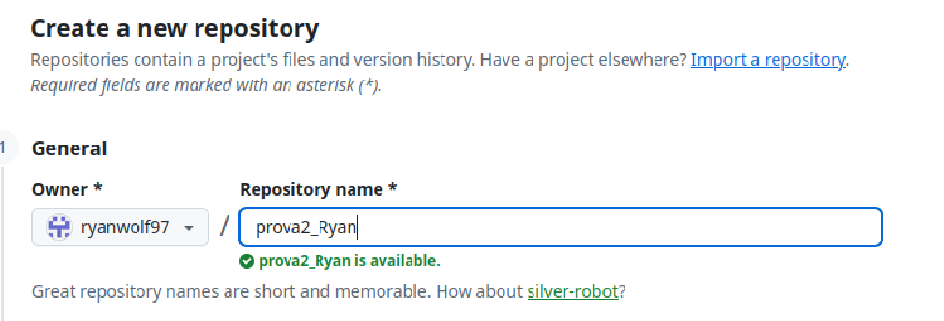

Ara, des de la terminal, utilitzaré les ordres per a pujar el repositori a GitHub.

**Figura 20. Puge el repositori a GitHub.**

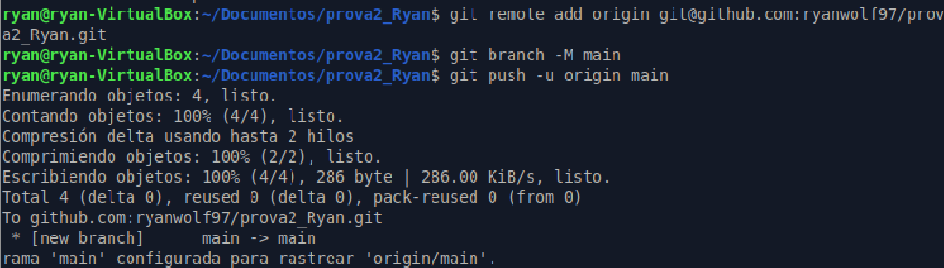

## Conclusió

Fent aquest exercici he entés ambdues formes de pujar i baixar un repositori, clonar-lo, modificar-lo i crear des de zero un repositori, fent ús de GitHub i de Git.

