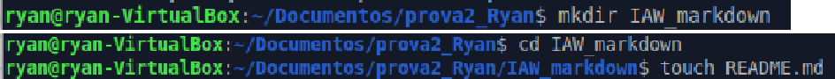
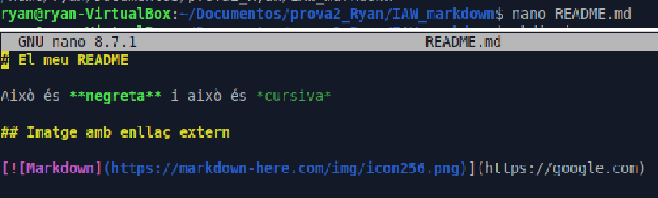
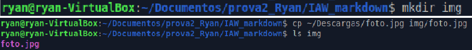
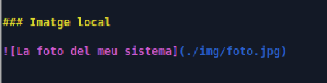
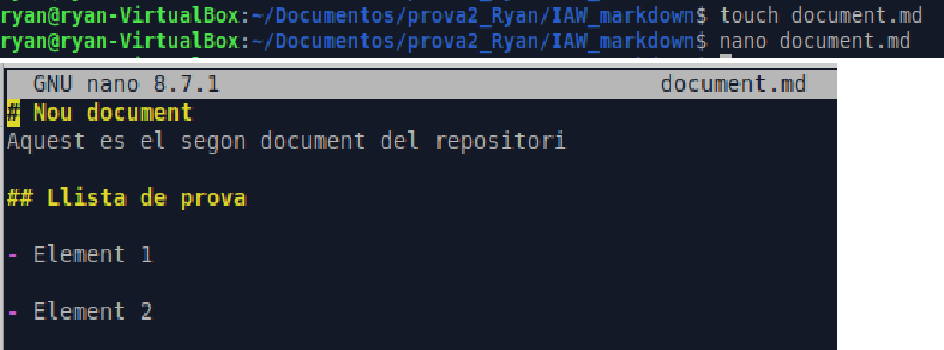
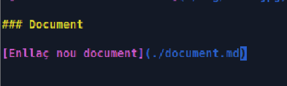
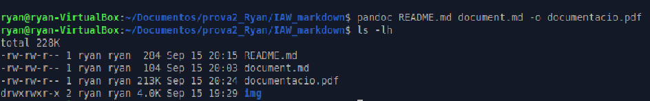

# IAW: Exercici 2

## Introducció a Markdown

**Alumne:** Ryan Alcañiz  
**Professor:** Juanjo Felis  
**Curs:** 2n ASIX

---

## 1. Crear la carpeta i el fitxer README.md

Crea una carpeta en un repositori local (creat en l’exercici anterior) que s’anomene `IAW_markdown` i que incloga un fitxer `README.md`.

**Figura 1. Cree la carpeta dins del repositori local i li afegisc un fitxer README.md.**

## 2. Afegir contingut amb sintaxi Markdown

Afegeix contingut al fitxer `README.md` utilitzant tots els elements de la sintaxi de Markdown que hem recordat.

**Figura 2. Afegisc al fitxer README.md elements de sintaxi Markdown i l’enllaç extern demanat a la pràctica.**

### Afegir una imatge al repositori

Crea un directori anomenat `img` al repositori i afegeix-hi una imatge.

**Figura 3. Cree el directori img i li afegisc una imatge.**

Incorpora la imatge que has afegit dins del document.

**Figura 4. Incorpore la imatge local.**

## 3. Crear un document Markdown nou

Crea un nou document Markdown al repositori.

**Figura 5. Cree un document Markdown nou i li introduïsc dades.**

## 4. Enllaçar el document nou des del README

Crea un enllaç des del fitxer `README.md` al nou document que acabes de crear.

**Figura 6. Cree l’enllaç al document Markdown.**

## 5. Generar un PDF des del fitxer Markdown

Genera un document PDF a partir del fitxer Markdown.

**Figura 7. Utilitzant Pandoc genere el document PDF a partir del Markdown i comprove que s’ha creat correctament.**

