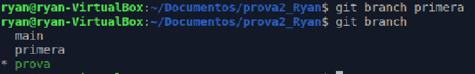
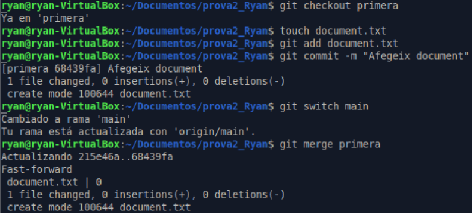
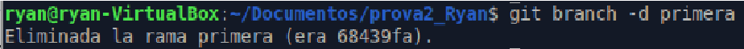
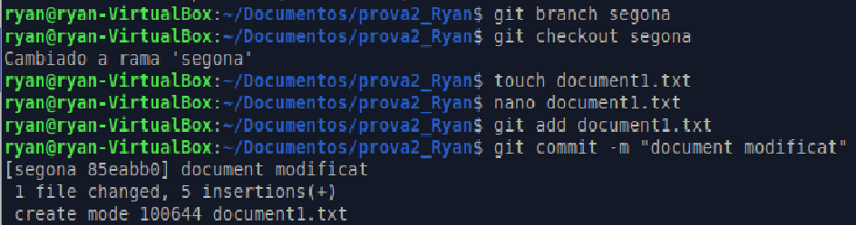
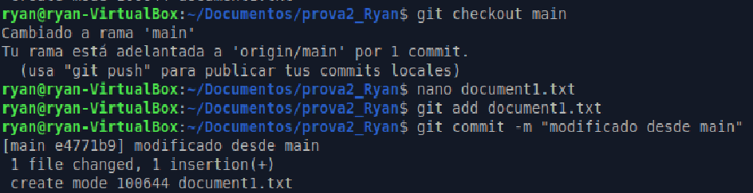
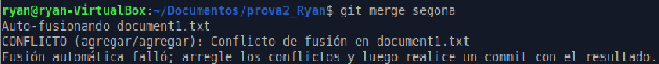
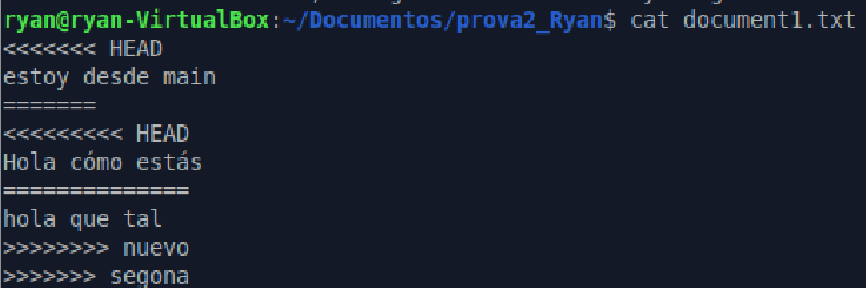
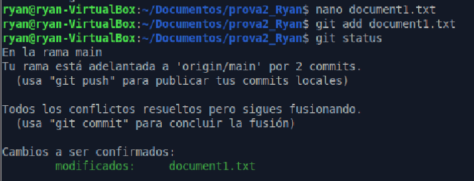
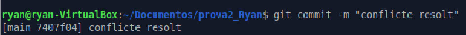
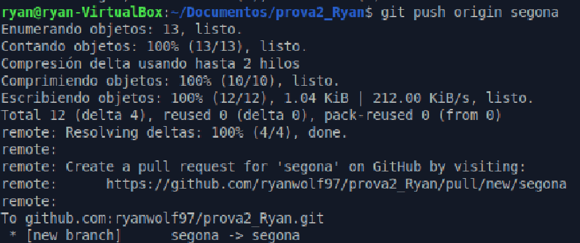

# IAW: Pràctica 3

## Branques i unions

**Alumne:** Ryan Alcañiz  
**Professor:** Juanjo Felis  
**Assignatura:** IAW  
**Curs:** 2n ASIX

---

## 1. Crear i comprovar una branca

Cree una branca anomenada `primera` al meu repositori local i execute la instrucció necessària per comprovar que s’ha creat.

**Figura 1. Cree la nova branca al meu repositori local.**

.

## 2. Crear un fitxer a la branca i fusionar-lo

Cree un fitxer nou en aquesta branca i el fusione amb la branca principal. S’ha produït un conflicte? Raone la resposta.

**Figura 2. Cree un fitxer nou en la branca principal i el fusione amb `main`.**

No s’ha produït cap conflicte perquè `document.txt` és un fitxer nou que no existia a la branca `main` i no hi havia canvis incompatibles.

## 3. Esborrar la branca `primera`

**Figura 3. Esborre la branca.**

## 4. Crear un conflicte en fusionar branques

Cree una branca anomenada `segona` i modifique un fitxer per produir un conflicte en fusionar-lo amb la branca principal. Lliure el contingut del fitxer on s’ha produït el conflicte.

**Figura 4. Cree la branca nova i el document que modifique.**

**Figura 5. Canvie a la branca principal i modifique el document des d’aquesta branca.**

**Figura 6. Fusione les branques i es produeix el conflicte.**

**Figura 7. Lliure el contingut del fitxer que ha causat el conflicte.**

## 5. Solucionar el conflicte i sincronitzar la branca remota

Solucione el conflicte creat en el punt anterior i sincronitze la branca `segona` amb el repositori remot.

**Figura 8. Modifique el contingut del document per solucionar el conflicte.**

**Figura 9. Faig un commit sense conflictes.**

**Figura 10. Sincronitze la branca `segona` amb el meu compte de GitHub.**

