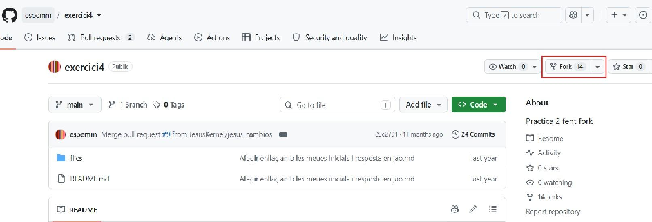
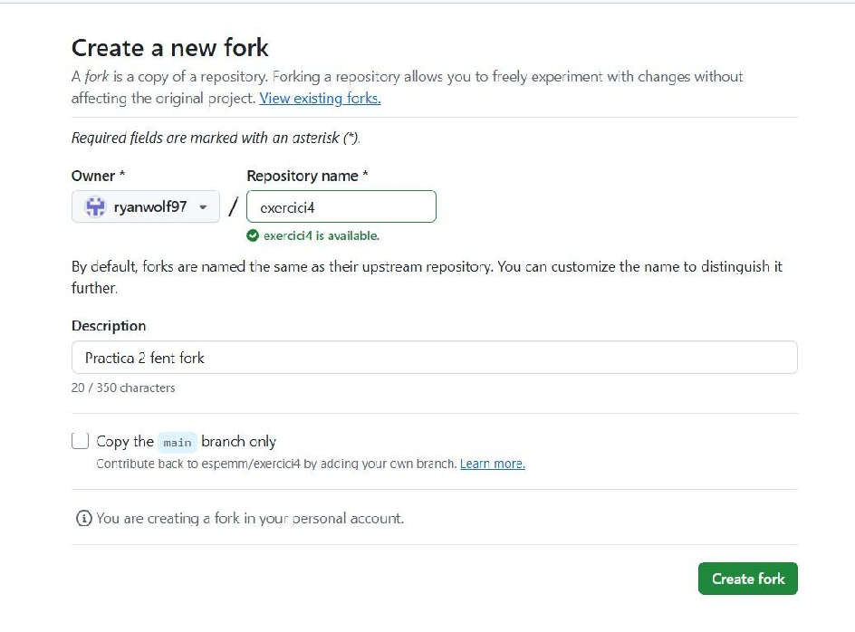
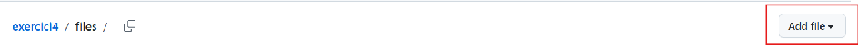
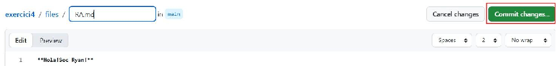
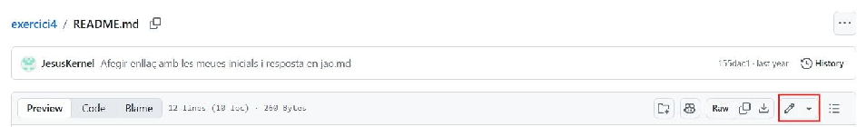
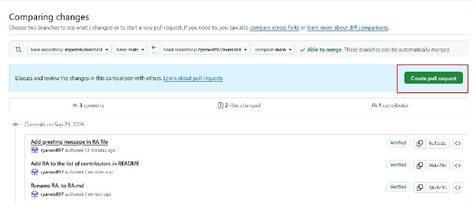
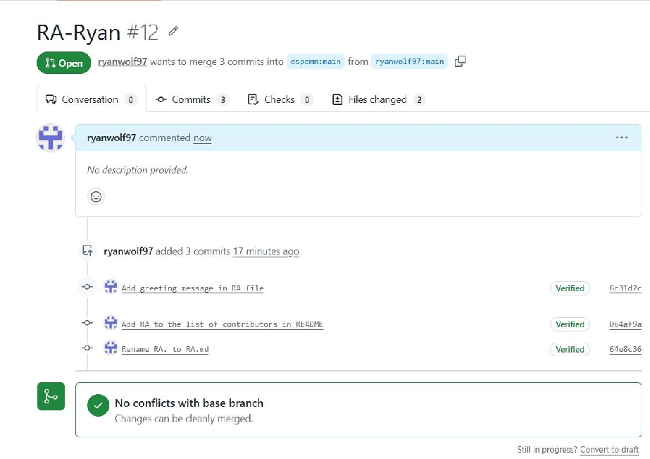

# IAW: Pràctica 4

## Col·laborant: Pull Request

---

## 1. Accedir a un repositori i fer-ne un fork

Accedisc a l’enllaç del repositori a GitHub i seleccione **Fork**.

**Figura 1. Accedisc a l’enllaç de GitHub i seleccione Fork.**

**Figura 2. Cree un fork nou.**

## 2. Afegir un fitxer al fork

Entre en **Files** i seleccione **Add file**.

**Figura 3. Entre en Files i seleccione Add file.**

Li pose un nom i afegisc dades.

**Figura 4. Li pose un nom i afegisc dades.**

## 3. Editar el README i confirmar els canvis

Entre dins de `README.md` i l’edite.

**Figura 5. Entre dins del README.md i l’edite.**

Afegisc dades i seleccione **Commit changes**.

**Figura 6. Afegisc dades i seleccione Commit changes.**

## 4. Crear un Pull Request

Des del meu GitHub, seleccione **Create Pull Request** per a fer el Pull Request.

**Figura 7. Des del meu GitHub seleccione Create Pull Request.**

**Figura 8. Confirmació del Pull Request al professor.**

