# IAW: Práctica 5

## MkDocs, Material y GitHub Pages

**Alumno:** Ryan Alcañiz  
**Profesor:** Juanjo Felis  
**Asignatura:** IAW  
**Curso:** 2.º ASIX

---

## 1. Crear un entorno virtual

**Figura 1. Creo el entorno virtual.**

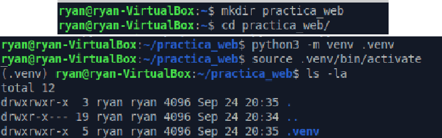

## 2. Instalar MkDocs Material

Instalo MkDocs Material y compruebo que se ha instalado correctamente.

**Figura 2. Instalo MkDocs Material y compruebo que se ha instalado correctamente.**

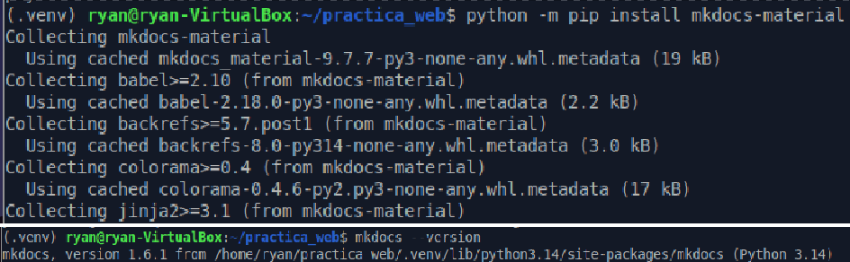

## 3. Crear el proyecto con MkDocs

**Figura 3. Creo el proyecto con MkDocs.**

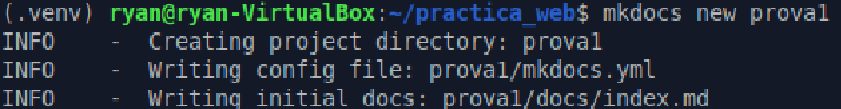

Entro en el directorio `docs` para editar el archivo `index.md`.

**Figura 4. Entro en el directorio docs para editar el archivo index.md.**

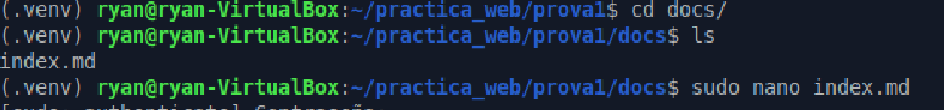

## 4. Editar el contenido y la configuración

Edito con Nano el archivo `index.md`.

**Figura 5. Edito con Nano el archivo index.md.**

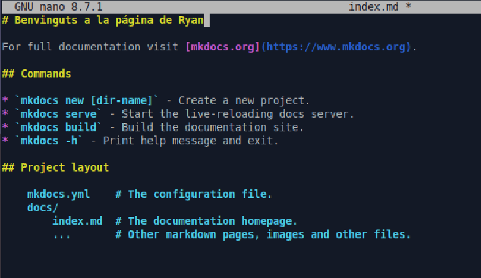

Añado contenido al archivo `mkdocs.yml`.

**Figura 6. Añado contenido al archivo mkdocs.yml.**

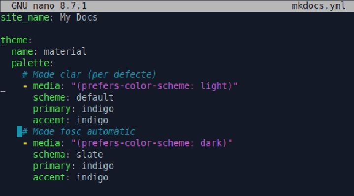

## 5. Ejecutar y comprobar el sitio

Ejecuto el servidor de MkDocs.

**Figura 7. Ejecuto el servidor MkDocs.**

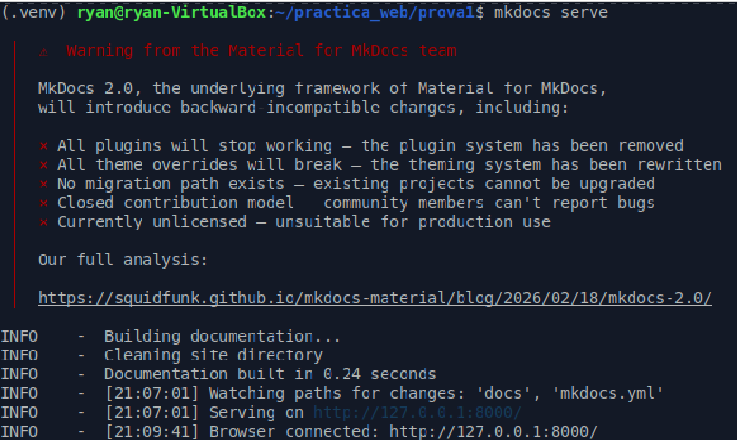

Compruebo que la página se muestra correctamente.

**Figura 8. Compruebo que mi página se muestra correctamente.**

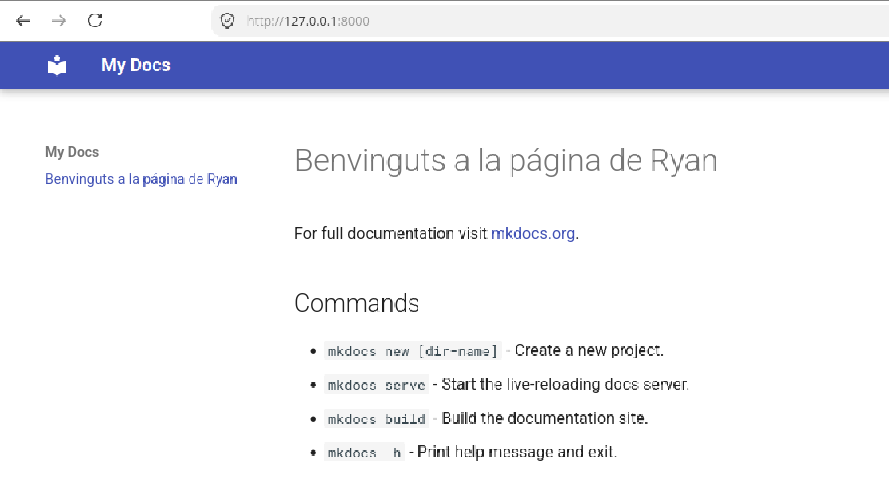

## 6. Generar el sitio web

**Figura 9. Genero el sitio web.**

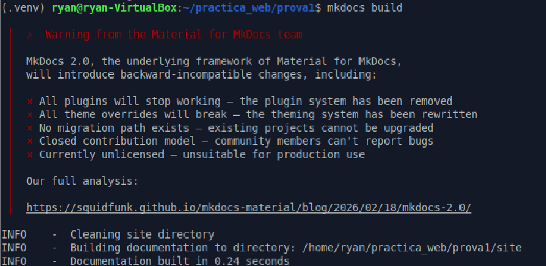

## 7. Crear el archivo .gitignore

Creo el archivo `.gitignore` y añado las rutas indicadas en la captura.

**Figura 10. Creo el archivo .gitignore y añado su contenido.**

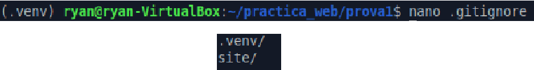

## 8. Preparar y subir el proyecto a GitHub

**Figura 11. Preparo Git para subir el proyecto.**

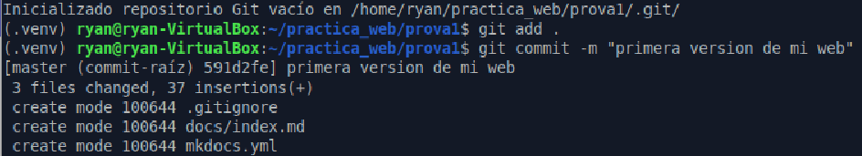

**Figura 12. Subo el proyecto a mi repositorio de GitHub.**

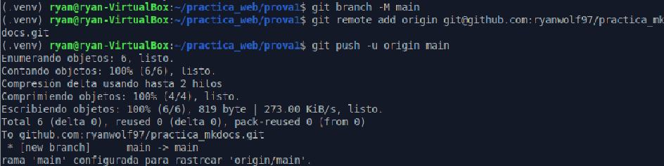
